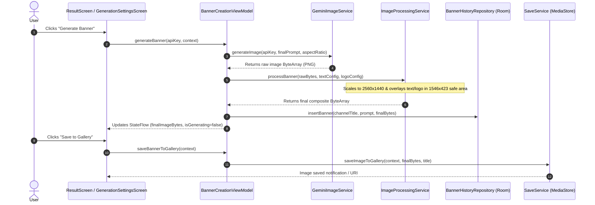

# Architecture Guide: BannerCraft

This document describes the software architecture, data flow, component design, and integration patterns for **BannerCraft**.

---

## 1. Architectural Pattern: Modern Android Architecture (MVVM)

BannerCraft strictly implements the official Android Architecture Guidelines with a reactive, unidirectional data flow (UDF):

```
+-------------------------------------------------------------+
|                        UI Layer                             |
|   (Jetpack Compose Screens + Soft Neumorphic Components)    |
+------------------------------▲------------------------------+
                               | Observes StateFlow (UI State)
                               | Emits Events / User Actions
+------------------------------▼------------------------------+
|                      ViewModel Layer                        |
|       (BannerCreationViewModel, ApiKeyViewModel, etc.)      |
+------------------------------▲------------------------------+
                               | Coroutines & Suspend Functions
                               | Flow Streams
+------------------------------▼------------------------------+
|                     Data & Service Layer                    |
|  - GeminiImageService (REST Client for Gemini 3.1)          |
|  - BannerHistoryRepository + BannerDatabase (Room)          |
|  - SecureStorageManager (EncryptedSharedPreferences)        |
|  - ImageProcessingService, TextOverlayService, SaveService  |
+-------------------------------------------------------------+
```

---

## 2. Layers & Responsibilities

### A. UI Layer (`com.example.ui`)
- **Single Activity**: [`MainActivity.kt`](file:///c:/Users/shuai/Downloads/bannerflow-navigator%20%281%29/app/src/main/java/com/example/MainActivity.kt) sets up edge-to-edge rendering, dark/light theme wrapper, and delegates navigation to `AppNavHost`.
- **Navigation**: [`NavGraph.kt`](file:///c:/Users/shuai/Downloads/bannerflow-navigator%20%281%29/app/src/main/java/com/example/navigation/NavGraph.kt) defines clear route constants (`Routes.SPLASH`, `Routes.HOME`, `Routes.PROMPT_BUILDER`, `Routes.GENERATION_SETTINGS`, `Routes.RESULT`, `Routes.IMAGE_STUDIO`, `Routes.HISTORY`, `Routes.SETTINGS`) with animated slide/fade transitions.
- **Design System (`com.example.ui.theme`)**:
  - Soft Neumorphism with dual-tone shadows:
    - Light: Base `#F0F4F9`, Dark shadow `#C2CBD6`, Light highlight `#FFFFFF`
    - Dark: Base `#202530`, Dark shadow `#101319`, Light highlight `#2C3342`
  - Accent Palette: Coral Red (`#FF4B4B`), Slate Neutral (`#505F76`), Safe Mint (`#00855B`).
  - Custom Compose Modifiers:
    - [`neumorphicConvex()`](file:///c:/Users/shuai/Downloads/bannerflow-navigator%20%281%29/app/src/main/java/com/example/ui/theme/Neumorphic.kt): Elevated card and button treatment.
    - [`neumorphicInset()`](file:///c:/Users/shuai/Downloads/bannerflow-navigator%20%281%29/app/src/main/java/com/example/ui/theme/Neumorphic.kt): Debossed inner shadow for fields.
    - [`tactilePressable()`](file:///c:/Users/shuai/Downloads/bannerflow-navigator%20%281%29/app/src/main/java/com/example/ui/theme/Neumorphic.kt): Elastic scale-down spring effect on click.

### B. State Management Layer (`com.example.state`)
- **`BannerCreationViewModel`**: Manages the end-to-end creation state, from topic prompt formulation, mood & color selection, to overlay configurations and the final execution pipeline.
- **`ApiKeyViewModel`**: Handles multi-provider profiles (Google Gemini, NVIDIA NIM, OpenAI Compatible, OpenRouter, Groq, DeepSeek), decoupled Chat & Image provider setups, sanitization, and persistent encrypted storage.
- **`PromptChatViewModel`**: Powers the AI Prompt Chat screen with live message history, suggested prompt pills, dynamic model discovery, and 1-tap model switching.
- **`AuthViewModel`**: Manages user authentication states (Google Sign-In, Email/Password login/registration, and guest mode) integrated with Firebase Authentication.
- **`AppThemeViewModel`**: Manages dark mode toggle state, surviving session navigation.
- **`HistoryViewModel`**: Exposes reactive `StateFlow<List<BannerHistoryItem>>` loaded from Room.
- **`ImageEditorViewModel`**: Houses state for custom image prompt transformations and adjustments.

### C. Data & Processing Layer (`com.example.data`)
- **`GeminiChatService`**:
  - Connects to Google's official 2026 chat models (`gemini-3.8-flash`, `gemini-flash-latest`, `gemini-3.7-flash`).
  - Supports dynamic model discovery via `v1beta/models` and multi-turn conversational formatting with alternating roles.
- **`OpenAiCompatibleService`**:
  - Integrates with NVIDIA NIM (`https://integrate.api.nvidia.com/v1`) for Chat (`meta/llama-3.2-11b-vision-instruct`).
  - Supports image generation with **FLUX.1 Dev** (`https://ai.api.nvidia.com/v1/genai/black-forest-labs/flux.1-dev`) and OpenRouter/custom endpoints.
- **`GeminiImageService`**:
  - Connects to `imagen-3.0-generate-002` and `gemini-3.1-flash-image` via `OkHttpClient`.
  - Sets `generationConfig.responseModalities = ["IMAGE"]`.
  - Parses response JSON candidates to extract base64-encoded PNG image data.
  - Features robust error handling for `InvalidApiKeyException` (401/403), `RateLimitException` (429), and network errors.
- **`ImageProcessingService` & Overlays**:
  - Ensures raw AI image is scaled and fitted to `2560 x 1440`.
  - Calculates safe areas using [`TargetDimensions.YOUTUBE_MOBILE_SAFE_AREA`](file:///c:/Users/shuai/Downloads/bannerflow-navigator%20%281%29/app/src/main/java/com/example/data/TargetDimensions.kt) (`1546 x 423 px`).
  - Positions channel name, subtext, and avatar/logo overlays safely so they are never clipped on smartphones, tablets, or desktops.
- **`SaveService`**:
  - Exports final composite bitmaps into Android's public `MediaStore.Images` collection under `Pictures/BannerCraft`.
- **`BannerDatabase` & `BannerHistoryRepository`**:
  - Local SQLite database backed by Room for offline review and preservation of generated artifacts.
- **`SecureStorageManager`**:
  - Handles encrypted storage of provider configurations, saved profiles, and API credentials via Android's `EncryptedSharedPreferences`.

---

## 3. Data Flow: Banner Generation Pipeline


